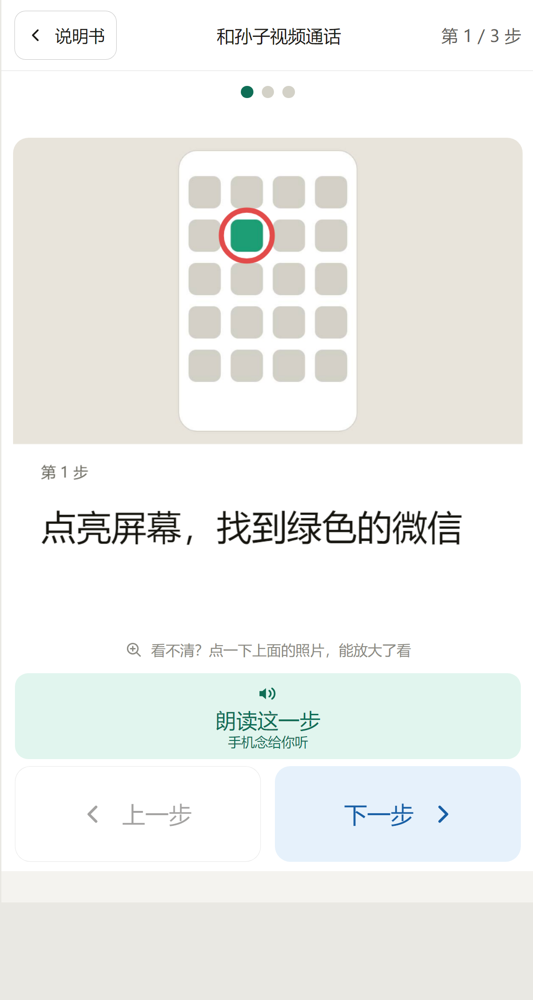
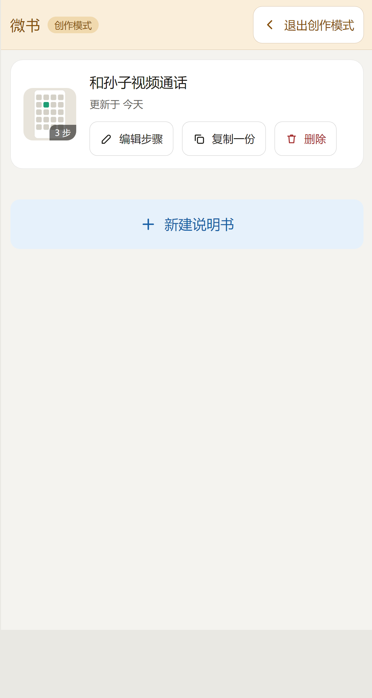
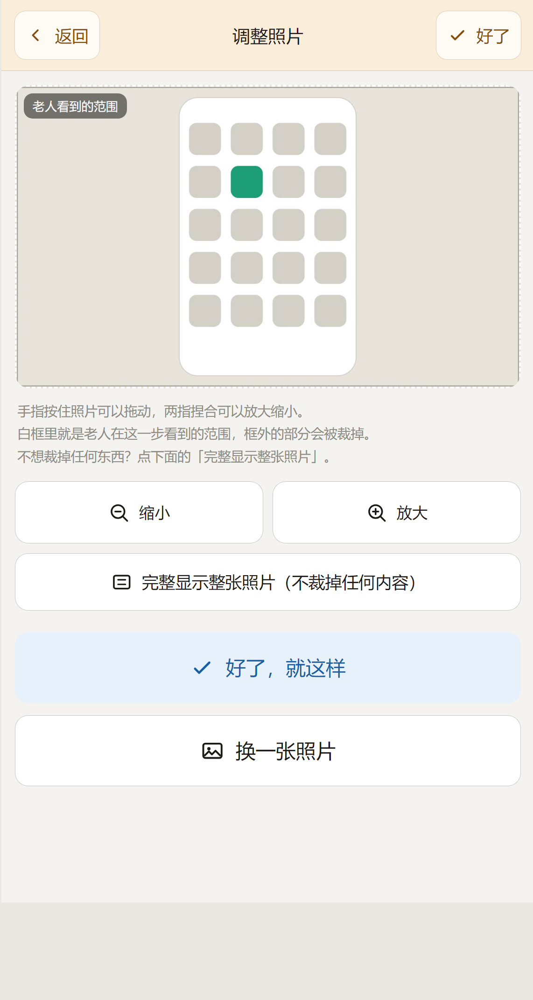

# 微书 WeBook

> 让儿女用三分钟做一份「图文分步说明书」，贴在冰箱上，父母照着做就行。

[**下载 APK（v1.4，1.7MB）**](./微书-v1.4.apk) ｜ [功能](#功能) ｜ [自己构建](#自己构建-apk) ｜ [技术实现](#技术实现)

<p align="center">
  
  
  
  
</p>

## 这是什么

很多老人用不了一些基本功能——不会发微信视频、不会用机顶盒、不会调空调。**他们真正焦虑的不是"不会操作"，而是"出问题时没人可问"。**

微书做的事很简单：**让家里那个懂的人，用手机拍几张照、写几句话，做出一份"照着做就行"的说明书。**

- 一份说明书 = 若干步骤，**一屏一步**，上面是照片（可以画红圈标出该点哪里），下面一句大白话
- 打印成 A4 纸贴在设备旁边，或者导出成图发到家人群
- 做好的说明书在老人手机上，用**超大字号**看，点一下还有**语音念给他听**——可以是机器念，也可以是**你自己录的家乡话**

## 两个角色，一个 App

| | 谁在用 | 看到什么 |
|---|---|---|
| **阅读模式** | 老人 | 打开就是大图大字，只能翻页、只能听，**改不动任何内容** |
| **创作模式** | 子女 / 志愿者 | 长按右上角 3 秒 + 确认一次才进得去，进去后有琥珀色顶栏和常驻的「退出创作模式」 |

> 老人动作慢，手会长时间搭在屏幕上。所以进创作模式必须是「长按 3 秒 → 弹窗确认（默认取消）」，短按完全没反应。

## 功能

### 阅读模式（给老人）

- 一屏一步，图片占大半屏，字号可到「巨大」
- 底部两个**巨大**的翻页按钮（不是滑动手势——老人常滑不动或滑过头）
- **两种听法**：有录音时，最上面是「听家里人说的」；没有就「机器朗读」兜底
- **点图片能全屏放大**，像微信点开图片那样，看清了再照着按
- 3 套配色（白底黑字 / 黑底黄字 / 米黄底棕字）
- 记住上次看到第几步，下次打开接着看

### 创作模式（给做说明书的人）

- **拍照 / 相册选图**，选完先进「调整照片」：白框标出老人实际看到的范围，可拖动、两指缩放，也可以一键「完整显示整张照片」不裁掉任何内容
- **手绘标注**：红圈、箭头、序号①②③、手绘，四种颜色，可撤销、可清空
- **每步可录一段自己的声音**（≤120 秒），方言也行。录音只存在手机里，不上传
- **任何一步随时能改**：字、图、圈、录音四项全能改
- **显式保存**：进说明书先改草稿，点「保存」才落盘；没保存就退出会弹窗问一次
- **导出**：PDF（A4，每页 1 步或 2 步）、长图（发微信）
- 导出后弹窗底部列出已导出的文件，每个都能**一键分享**（微信、打印店）或删除

## 下载安装

1. 下载本页顶部链接的 `微书-v1.4.apk`（就在仓库文件列表里，点开即下）
2. 手机点开安装，系统提示「未知来源」时允许一次
3. **首次打开不申请任何权限**——老人点开就能看

权限只在真正用到时问一次，答应过就记住：

| 什么时候 | 手机问什么 |
|---|---|
| 打开 App | 什么都不问 |
| 拍照 | 不问（调用系统相机，它自己有权限） |
| 从相册选图 | 只有 Android 12 及以下才问「访问照片」 |
| 第一次录音 | 问「使用麦克风」；不给也照样能用机器朗读 |
| 第一次导出 | 只有 Android 9 及以下才问「写入存储」 |

## 隐私

- **不联网**、不登录、无广告、无埋点、不收集任何数据
- 说明书、照片、录音全部存在手机本地
- 录音永远不会被导出，也永远不会离开这台手机

## 技术实现

没有框架，没有构建工具链，就是一份 HTML：原生 HTML/CSS/JS + 一个极薄的 Android WebView 壳。

```
prototype/     网页本体（就是产品的真身，装进壳里直接变 APK）
  index.html   界面结构
  app.css      样式（留白按 --sp 比例单位换算，适配各种屏宽）
  app.js       全部逻辑：卡片绘制、手绘标注、裁切、录音、导出
  vendor/      jsPDF（本地打包，不走 CDN）
  build.js     把三个文件合成一份单文件 HTML
 微书-原型.html  可以直接在浏览器里打开的单文件版
android/       Android 壳（Gradle 工程，minSdk 26）
docs/          需求文档
```

几个值得说的实现选择：

- **导出 PDF 不是截屏**，是用 Canvas 把每一步重新画一遍再塞进 PDF——中文绝不会变方块字
- **绝对不能用 `pdf.save()`**：那是"造个下载链接再点一下"，在 WebView 里等于什么都没发生；必须 `pdf.output('datauristring')` 交给原生写文件
- 几 MB 的图片数据**不能一整串穿过 JS 桥**（会被截断），切成 64KB 一段传
- 留白不写死像素，统一用「屏宽的 1%」当比例单位，大屏宽松小屏收紧
- 老人端优先大按钮，不用滑动、不用图标暗示——**重要按钮一律「图标 + 文字」**

## 自己构建 APK

需要 JDK 17 + Android SDK（platform 34 / build-tools 34.0.0）。

```bash
# 1. 生成单文件网页
cd prototype && node build.js

# 2. 同步进 Android 工程
cd ../android && node sync-web.js

# 3. 打包
export JAVA_HOME=/path/to/jdk-17
export ANDROID_HOME=/path/to/Android/Sdk
gradle assembleRelease
# 产物：app/build/outputs/apk/release/app-release.apk
```

只想改界面看看效果？直接用浏览器打开 `prototype/微书-原型.html` 就行——它和 App 里跑的是同一份代码。

## 已知的边界

- 说明书和照片存在 App 的网页存储里（约 5MB 上限），十几步的说明书完全够用，但照片太多会不够
- 录音存在 `localStorage`，一部手机大约能放 30 段十几秒的话
- 还没有云同步和跨手机迁移（本来也不打算做——数据不出手机）

## 许可

[MIT](LICENSE) —— 随便用，随便改。

如果这个小工具帮到了你家里的老人，那就是它存在的全部理由。
